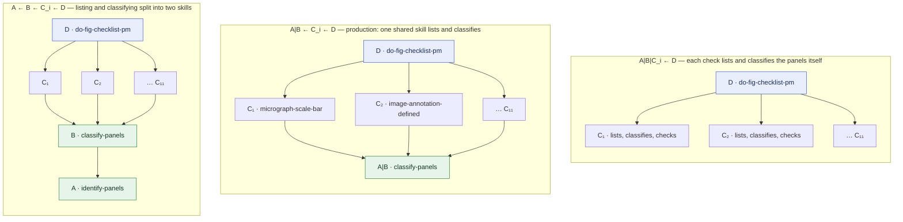
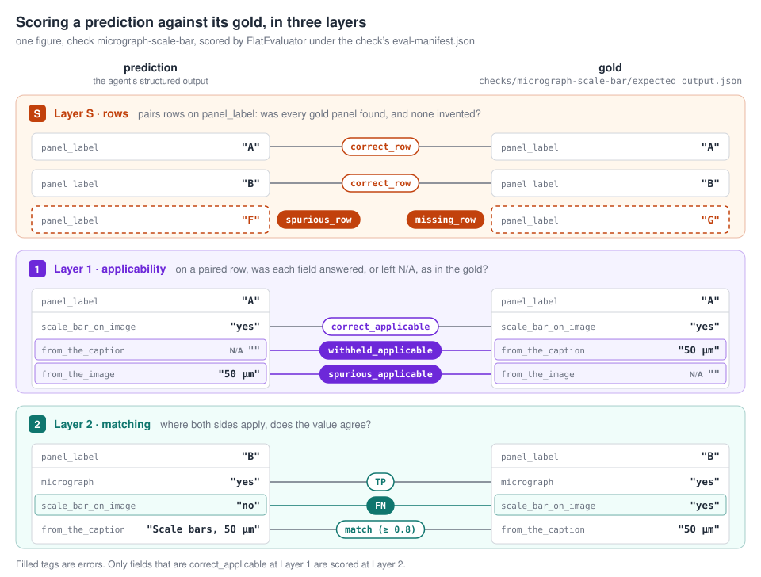

# mmQC

An open library of multimodal editorial AI skills for manuscript quality
control, benchmarked against curated gold.

A check — *is every micrograph given a scale bar?*, *are the error bars
defined in the caption?* — is an **agent skill**: a `SKILL.md` an agent reads
and follows, with a JSON contract for its answer and a benchmark of curated
examples to score it against. Checks are grouped into **checklists**; the
production one, `fig-checklist`, runs eleven figure checks over one figure in
a single agent session.

## Hierarchical skills

Checks share work. Every figure check first needs the figure's panels — what
they are labelled, what each shows — before it can judge any of them. In
agentic mmQC that shared work is **a skill of its own**, which the checks
invoke instead of repeating it, and the checklist is **a skill that invokes
the checks**. Skills form a directed acyclic graph: each one names, in its
prose, the skills it calls with the agent's `Skill` tool, and the runner
assembles exactly the skills an entry point reaches.

Four roles, in the notation of the experiments:

| | skill | role |
|---|---|---|
| **A** | `identify-panels` | list the figure's panels (experiment checklists only; production merges A and B) |
| **B** | `classify-panels` | classify each panel by content (micrograph, plot, blot, …) |
| **C_i** | the eleven checks | judge one thing, panel by panel |
| **D** | `do-fig-checklist-pm` | the entry point: run every check, return one answer — one row per panel |

`A ← B` reads "A is invoked by B", and `A|B` is A and B done by one skill.
How far the shared work is split out, and where it sits, gives different
arrangements of the same skills:



Arrows point from caller to callee. A session holds one figure; the entry
point is the only skill the runner names, and every other hop is the agent's
own call, recorded in the session's skill trace.

**Which arrangement, and why.** The experiments compared them on the same
figures, gold and contracts (layer S: the share of panels correctly found,
counting both missing and spurious ones):

| | `A\|B\|C_i ← D` | **`A\|B ← C_i ← D`** | `A ← B ← C_i ← D` |
|---|---|---|---|
| exp-04 — three checks, Sonnet 5 | 0.979 | **0.997** | 0.991 |
| exp-08 — eleven checks, Sonnet 5.5 | | **0.997** | 0.977 |
| exp-09 — eleven checks, Sonnet 5.5 | 0.995 | **0.997** | |

Sharing the panel inventory makes every check work from the same list of
panels — the eleven checks' lists agree in nearly every session. Splitting it
further costs more than it gains: one level deeper, the agent more often stops
after the first check (exp-08: in 57 of 185 sessions, against 14), and on the
sessions that run every check the two are level. **Production is
`A|B ← C_i ← D`**, run by Sonnet 5.5, which exp-07 found level with Opus 5.5
and ahead where they differ, at under half the cost. Every check doing its
own panels (`A|B|C_i ← D`) is as accurate (exp-09) but costs a third more.

**The answer is panel-major.** One row per panel — its label, its content
classes, then each check's fields under the check's name — rather than one
list per check (exp-10). The same two panels and two of the eleven checks, in
each shape (abridged):

*Check-major* — one list per check; every list names the panels again:

```json
{
  "micrograph-scale-bar": [
    {"panel_label": "A", "micrograph": "yes", "scale_bar_on_image": "yes", "…": "…"},
    {"panel_label": "B", "micrograph": "no", "scale_bar_on_image": "not_applicable", "…": "…"}
  ],
  "error-bars-defined": [
    {"panel_label": "A", "is_a_plot": "no", "decision": "not_applicable", "…": "…"},
    {"panel_label": "B", "is_a_plot": "yes", "error_bar_on_figure": "yes", "decision": "PASS", "…": "…"}
  ],
  "…": "nine more checks, each with its own list of panels"
}
```

*Panel-major* — one list of panels; each check's fields under its name:

```json
{
  "outputs": [
    {
      "panel_label": "A",
      "panel_classes": ["micrograph"],
      "micrograph-scale-bar": {"micrograph": "yes", "scale_bar_on_image": "yes", "…": "…"},
      "error-bars-defined": {"is_a_plot": "no", "decision": "not_applicable", "…": "…"},
      "…": "nine more checks"
    },
    {
      "panel_label": "B",
      "panel_classes": ["plot"],
      "micrograph-scale-bar": {"micrograph": "no", "scale_bar_on_image": "not_applicable", "…": "…"},
      "error-bars-defined": {"is_a_plot": "yes", "error_bar_on_figure": "yes", "decision": "PASS", "…": "…"},
      "…": "nine more checks"
    }
  ]
}
```

Check-major states panel A eleven times, once in each check's list, and
nothing makes the lists agree; panel-major states it once, so the checks
cannot disagree about which panels exist, and scoring aligns one panel list
instead of eleven. Each check's fields are the same in both shapes — only
where they sit differs. The two were level on accuracy; panel-major
dispatched a little more reliably and cost a little less.

## The figure checklist

`soda_mmqc/data/checklist/fig-checklist/`, eleven checks, each one panel by
panel:

| check | asks |
|---|---|
| `micrograph-scale-bar` | does every micrograph carry a scale bar, with its length stated on the image or in the caption? |
| `image-annotation-defined` | are arrows, boxes, dashed lines and other annotations on images explained in the caption? |
| `single-channel-for-overlay` | is each channel of a multicoloured overlay also shown on its own? |
| `individual-data-points` | does a plot of averages also show the individual data points? |
| `error-bars-defined` | are error bars, and box or violin plot elements, explained in the caption? |
| `plot-axis-units` | do the axes of quantitative plots state their units? |
| `plot-gap-labeling` | is any break in a plot's axis marked? |
| `stat-significance-level` | are significance symbols, such as asterisks, defined in the caption? |
| `stat-test` | does a panel claiming significance name the test behind it? |
| `replication-reporting` | is the number of replicates reported, and what they represent? |
| `panel-image-matches-caption` | does the image contradict what the caption says it shows? |

Each check also runs on its own: it invokes `classify-panels` itself.

`doc-checklist` holds earlier, prompt-based checks not yet converted to
skills.

## Installation

Requires **Python 3.12+**. Dependencies are in `pyproject.toml`; use **uv**
(recommended) or pip.

```bash
git clone https://github.com/source-data/mmQC.git
cd mmQC
uv sync                       # or: python -m venv .venv && pip install -e .
source .venv/bin/activate
```

Two packages live beside `soda_mmqc` and are installed from their folders:
[mmqc-harness](mmqc_harness/README.md), the agentic harness that applications
install too, and [mmqc-utils](mmqc_utils/README.md), the conversions it and
production share. The agent runtime is the Claude Agent SDK
(`claude-agent-sdk`, pinned in `mmqc_harness/pyproject.toml`: a silently
updated runtime would make scores non-comparable). Every figure is converted
for the model as production converts it, so install
[ImageMagick](https://imagemagick.org/download/) and, on macOS with Homebrew,
set `MAGICK_HOME=/opt/homebrew/opt/imagemagick` in `.env`.

## Configuration

Create a `.env` in the project root:

```bash
ANTHROPIC_API_KEY=...     # for --provider claude-sdk, the default
OPENAI_API_KEY=...        # for --provider openai
DEVICE=cpu                # cpu, cuda or mps, for the scorer's sentence embeddings
MAGICK_HOME=...           # ImageMagick; macOS + Homebrew: /opt/homebrew/opt/imagemagick
```

The model comes from the checklist's `model-defaults.yaml`
(`claude-sonnet-5-5` for `fig-checklist`) unless `--model` says otherwise.
[Langfuse](https://langfuse.com) (`LANGFUSE_PUBLIC_KEY`,
`LANGFUSE_SECRET_KEY`, `LANGFUSE_BASE_URL`) is where production checklists
are published (see [In production](#in-production)). It also serves the
curation app's prompt management and tracing. Without it, local files are
used and tracing is off. See [API providers](soda_mmqc/docs/api_providers.md).

## Usage

One command, `mmqc`:

```bash
# Run the whole figure checklist on every benchmark figure, 38 sessions at a time.
# A live run must be scoped with --limit or --example.
mmqc run fig-checklist --check do-fig-checklist-pm --limit 37 --concurrency 38 \
    --output runs/fig-checklist

# One check on its own, on one figure.
mmqc run fig-checklist --check micrograph-scale-bar --example <doc>/content/<n>

# Offline: each example's gold becomes its prediction; exercises the whole path
# -- assembly, prediction layout, trace, scoring -- with no credentials.
mmqc run fig-checklist --check do-fig-checklist-pm --mock

# Score a run against the gold.
mmqc score fig-checklist --check do-fig-checklist-pm --predictions runs/fig-checklist/pinned/rep-00

# Draft gold for new examples from a run, so curation is correction, not typing.
mmqc init fig-checklist --check micrograph-scale-bar --from-run runs/...

# Build one example's sealed runtime and print its permission profile, without a session.
mmqc assemble fig-checklist --check do-fig-checklist-pm --example <doc>/content/<n> --keep-runtime

# Check, or regenerate, a checklist's generated dag.yaml and README.md.
mmqc graph fig-checklist [--write]

# Curation and reporting apps (Streamlit).
mmqc curate fig-checklist
mmqc report runs/fig-checklist --checklist fig-checklist --check do-fig-checklist-pm
```

`--replicates N` runs each configuration N times (a non-deterministic system
has no seed; replicates are how its variance is measured). `--unpin SKILL
--versions v1,v2` compares versions of one skill with everything else pinned,
each version's predictions in its own directory. A rerun skips what already
has a prediction, so an interrupted run resumes; an account or connection
error stops the run at once.

A run writes `<output>/<arm>/rep-NN/<example>/prediction.json`, with
`intermediates/` beside it:
- `skill_trace.json`: which skills the agent invoked;
- `tool_audit.json`: every tool call, cost, tokens, the model that wrote each
  message, and a fingerprint of each image sent (media type, size,
  dimensions, SHA-256);
- `failure.json`, for a session that failed.

Each figure is sent as production sends it: converted once by
`mmqc_harness.figure_parts` (300 dpi, longest side 2,048 px, JPEG quality 80).
exp-11 found this non-inferior to the stored files that earlier runs sent.

## Checklists and skills on disk

```text
soda_mmqc/data/checklist/fig-checklist/
├── version-manifest.yaml        # pins one version of every skill
├── model-defaults.yaml          # model and session knobs (e.g. max_turns)
├── dag.yaml, README.md          # generated by `mmqc graph --write`; never hand-edit
├── do-fig-checklist-pm/         # D: the entry point, answering one row per panel
│   ├── schema.json              #   its contract, derived from the checks'
│   ├── eval-manifest.json
│   ├── benchmark.json
│   └── v1/SKILL.md
├── classify-panels/             # A|B: a shared skill -- no contract, never scored
│   └── v1/SKILL.md
├── micrograph-scale-bar/        # C_i: a check
│   ├── schema.json              #   the answer's structure
│   ├── eval-manifest.json       #   how each field is scored
│   ├── benchmark.json           #   which examples it is scored on
│   ├── prompts/                 #   prompt versions of the prompt-based runner
│   └── v2/SKILL.md              #   earlier versions live in git history
└── …
```

A check owns `schema.json` and `benchmark.json`; a shared skill does not, and
is never scored on its own. The contracts sit above the version directories,
so two versions of a skill are scored against the same contract.

**Versions.** A run uses the versions `version-manifest.yaml` pins, and it
must pin every skill: a missing pin, or one naming a skill or version that
does not exist, refuses. Adding `v3/SKILL.md` changes nothing until its pin
moves, so a result is attributed to a reviewed set of versions, not to
whatever is highest on disk. Experiments keep their own frozen copies
(`fig-checklist-exp01` … `-exp11`).

**The production checklist holds one topology.** `fig-checklist` contains
the production entry point, the skills it reaches and their contracts.

- Versions of a skill may differ in prose, never in which skills they call.
- Exactly one skill is called by no other, and it owns a `schema.json`.
- Every pinned skill is reached from it.

`mmqc graph` checks these rules for the checklists listed under `skills` in
`soda_mmqc/data/production_prompts/production.json`. A different arrangement
belongs in an experiment copy.

**Skill frontmatter.** `requires` names the skills a skill calls — its edges
in the DAG — and `produces` what it returns; the prose must call each
required skill with the `Skill` tool, and the tests check that it does.

## How a session is contained

Each example gets a throwaway directory **outside the repository**, holding
the entry point's closure of skills, that one example's staged content, and
nothing else: no other example, no gold, no benchmark, no repository path.

- **The content travels in the request:** the caption, and the figure
  converted for the model.
- **The agent has one tool, `Skill`,** and answers through the structured
  output its contract defines.
- **Everything else is removed by name:** shells, subagents, network access,
  and every egress or scheduling tool.
  [`mmqc_harness/src/mmqc_harness/runtime.py`](mmqc_harness/src/mmqc_harness/runtime.py)
  gives the reason for each. Widening that set is a deliberate decision, not
  a configuration edit.


## Benchmarking and scoring

Gold lives beside the examples:

```text
soda_mmqc/data/examples/{doc_id}/content/{figure_id}/
├── content/{image, caption.txt}
└── checks/{check}/expected_output.json      # curated gold for one check
```

`FlatEvaluator` compares a prediction with its gold, field by field, under
the check's `eval-manifest.json`, and reports three layers:

| layer | question |
|---|---|
| **S** | were the right rows found — every gold panel, and no invented one? |
| **1** | was each field judged applicable or not applicable as in the gold? |
| **2** | where both say it applies, does the value match? |



Gold changes are curated and **tagged** (`gold-v1` … `gold-v7`); an
experiment pins the tag it is scored against with `soda_mmqc.gold.pin_gold`,
so later curation never moves its numbers. Details in
[Benchmarking and evaluation](soda_mmqc/docs/benchmarking.md).

## Experiments

How skills are written, arranged and run is studied in preregistered
experiments: the question, endpoints and decision rules are committed before
the run, the runs and their notebooks after. See
[`thinking/experiments/`](thinking/experiments/README.md).

| | question | result |
|---|---|---|
| [exp-03](thinking/experiments/exp-03-checklist-entry.md) | does running the checks through one entry skill degrade them? | not two of three; `error-bars-defined` lost applicability |
| [exp-04](thinking/experiments/exp-04-panel-major.md) | three arrangements; answers per check or per panel | `A\|B ← C_i ← D`, per check |
| [exp-05](thinking/experiments/exp-05-shared-step-first.md) | the shared step first, run by the entry point | breaks dispatch |
| [exp-06](thinking/experiments/exp-06-full-checklist.md) | all eleven checks in one session | holds; the baseline |
| [exp-07](thinking/experiments/exp-07-models.md) | Opus 5.5, Sonnet 5.5, Haiku 5.5 | Sonnet 5.5 |
| [exp-08](thinking/experiments/exp-08-arrangements-sonnet.md) | the arrangements again, on exp-07's configuration | `A\|B ← C_i ← D` stays |
| [exp-09](thinking/experiments/exp-09-inline-panels.md) | every check doing its own panels, `A\|B\|C_i ← D` | as accurate, a third dearer; `A\|B ← C_i ← D` stays |
| [exp-10](thinking/experiments/exp-10-panel-major-revisited.md) | per check or per panel, on eleven checks | level; production switches to per panel |
| [exp-11](thinking/experiments/exp-11-input-parity.md) | the figure converted as production converts it, against the stored file | non-inferior; every run now sends the converted figure |

The open problem is **partial dispatch**: in 5–15% of sessions, depending on
the model, the agent runs the first check and answers the rest without
invoking them.

## In production

The harness that runs a session is a package of its own,
[`mmqc-harness`](mmqc_harness/README.md), beside `soda_mmqc` in this
repository. mmQC benchmarks with it, and applications install it, so a
benchmark score describes what production runs: the same skill files, the
same session, the same figure conversion.

1. **Publishing.** The checklists listed under `skills` in
   `soda_mmqc/data/production_prompts/production.json` are published to
   Langfuse: one prompt per pinned skill, `skills/<checklist>/<skill>`,
   labelled `production`. Each prompt holds the whole `SKILL.md`, with its
   contracts and the release (the digest of the skill set) in its config.
   `.github/scripts/publish_langfuse_skills.py` publishes, skips a release
   Langfuse already has, and verifies by loading it back; `--dry-run` shows
   the payloads without credentials.
2. **Pulling.** An application keeps a local copy with `mmqc-skills pull`
   (atomic and verified), checks it offline with `mmqc-skills verify`, and
   asks `mmqc-skills status` whether a newer release is out.
3. **Running.** It then runs the checklist on its own figures with
   `mmqc_harness`, as described in the package's README.

The integration with soda-curation, the production application, is planned
in [`thinking/plans/2026-10-23-harness-in-mmqc-utils.md`](thinking/plans/2026-10-23-harness-in-mmqc-utils.md).

## Reporting

`mmqc report <run root> --checklist … --check …` opens a local app for
finding the panels that pull a check's scores down. For one check of the run
(a checklist run holds all eleven), each property is a bar — its mean score
over examples and replicates — with one dot per panel, at that panel's score
averaged over the replicates that scored it. Clicking a dot shows the figure,
its caption, and the panel's gold against each replicate's prediction. Without
a run root it lists what `mmqc score` wrote under `data/evaluation/`. `export-fig-report` freezes a
snapshot as static HTML. The experiments' notebooks, under
`notebooks/experiments/`, use `soda_mmqc.reporting` directly.

## Testing

```bash
pytest
```

Tests under `tests/` hold the production design in place — the skill graph,
the pins, the containment profile, the contracts and the gold conventions.
Tests that call a live API are marked `integration` and deselected by
default; `pytest -m integration` runs them, each skipping without its
provider's key.

The two packages have their own suites, run in their own environments:

```bash
(cd mmqc_harness && uv run --group test pytest)   # never calls a model; no soda_mmqc
(cd mmqc_utils && uv run --group test pytest)
```
